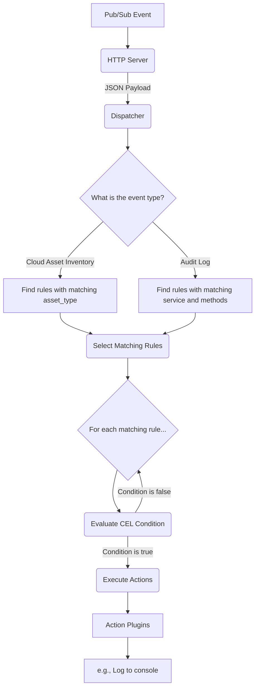

# governo
This application aims to provide generally usable way to process events from Google Cloud. It's designed to take in Cloud Audit / Cloud Asset Inventory events and then allows you to define rules based on the event payload. It uses CEL under the hood for the condition language. It currently reads the rules from `config.yaml` file and reloads the config when there is changes made to it.

## Actions

## Flow

